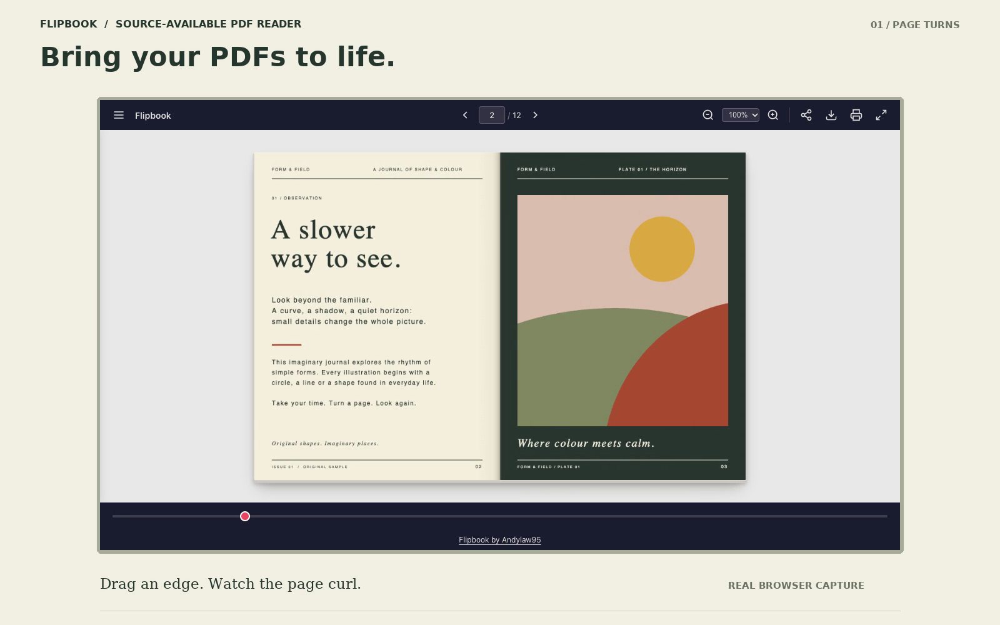

# Flipbook demo

[Watch the 28-second video](media/flipbook-demo.mp4) ·
[Download the 12-page sample](../examples/form-and-field.pdf)

## What the video shows

| Time | Recorded behavior |
| --- | --- |
| 0–7 s | Cover opens with an edge drag; a second drag turns the spread, showing the curved leaf and moving shadows. |
| 7–12.8 s | Toolbar zoom moves from 100% to 125% to 150%; dragging pans; zoom returns to 100%. |
| 12.8–18 s | The fullscreen button enters native fullscreen, navigation advances the spread, and the button exits fullscreen. |
| 18–24 s | A 390 × 844 browser viewport shows a single page, a real touch turn, and the next-page control. A desktop screenshot is shown alongside it. |
| 24–28 s | Project call to action with a still captured during a real page turn. |

This is a silent recording with explanatory titles. All app motion comes from
the public v1.0.0 reader with its visible author credit. Loading lead-ins were removed; editorial framing
and cuts were added outside the app. Playback uses the original interaction
speed. No generated app frames, animation interpolation, or mocked features
are used.

## Files

| File | Format / intended use |
| --- | --- |
| [flipbook-demo.mp4](media/flipbook-demo.mp4) | 28 s; 1600 × 1000; 25 fps; H.264, yuv420p; fast-start playback. |
| [flipbook-preview.gif](media/flipbook-preview.gif) | 7 s looping preview; 800 × 500; 12 fps; suitable for the README. |
| [flipbook-demo.webp](media/flipbook-demo.webp) | Full 28 s animated alternative; 800 × 500; 12 fps. |
| [poster.png](media/poster.png) | Static poster with the editorial title. |
| [desktop.png](media/desktop.png) | Unframed 1280 × 720 desktop screenshot. |
| [page-turn.png](media/page-turn.png) | Unframed screenshot captured while dragging a page. |
| [zoom.png](media/zoom.png) | Actual 150% zoom and pan. |
| [fullscreen.png](media/fullscreen.png) | Actual native fullscreen state. |
| [mobile.png](media/mobile.png) | Unframed 390 × 844 phone-sized cover view. |
| [mobile-reading.png](media/mobile-reading.png) | Phone-sized single-page reading view. |

## Capture provenance and limits

Source: [Andylaw95/flipbook](https://github.com/Andylaw95/flipbook),
[v1.0.0 release](https://github.com/Andylaw95/flipbook/releases/tag/v1.0.0).
The release identifies its exact source commit. App behavior was not modified
for the capture.

Captured in an isolated Chrome 154.0.8037.99 context against a localhost-only
static server. The desktop app viewport was 1280 × 720; the phone-sized viewport
was 390 × 844 with touch emulation. All interactions used real mouse or touch
input. Native fullscreen was verified by `document.fullscreenElement.id ===
'app'`, with fallback mode false, then confirmed exited. The app-only capture
omits browser chrome; native fullscreen can look similar within this framing.

Phone footage is browser emulation, not a physical-device certification.
Fullscreen availability still depends on browser support, activation, and
embedding permissions. These assets do not claim universal browser or device
support. The page curl uses the reader's existing projected strips.

The sample download was byte-for-byte identical to the original PDF. Captured
sessions reported no page errors and requested only same-origin local files.
The browser suite covers Chromium and WebKit on desktop and mobile, including
credit visibility, keyboard focus, narrow iframes and fullscreen. Lint,
JavaScript syntax checks, static release verification and dependency audit
are recorded with the release validation.

## Privacy and credits

Only this isolated public app's viewport was captured. Browser address bars,
existing browser profiles, notifications, other tasks, and desktop windows
are absent. The sample is newly created neutral artwork. Its metadata uses
the public title and “Flipbook contributors”; there are no embedded files,
active actions, private endpoints, or personal contact details.

Original sample text, vector illustrations, editorial layouts, and demo
documentation were created for this project and use the root
[Flipbook Source-Available License 1.0](../LICENSE). Earlier MIT copies retain
their existing rights; see [the transition record](LICENSING.md).
The sample's source is [included](../examples/generate_sample.py).
There is no purchased media, stock photography, or music.

Editorial title typography uses DejaVu Sans and DejaVu Serif, rendered into
the video. Their notice is retained in [LICENSE-DejaVu.txt](media/LICENSE-DejaVu.txt).
The PDF uses standard Helvetica and Times font names. The reader's PDF.js and
standard-font notices remain in [THIRD_PARTY_NOTICES.md](../THIRD_PARTY_NOTICES.md).
