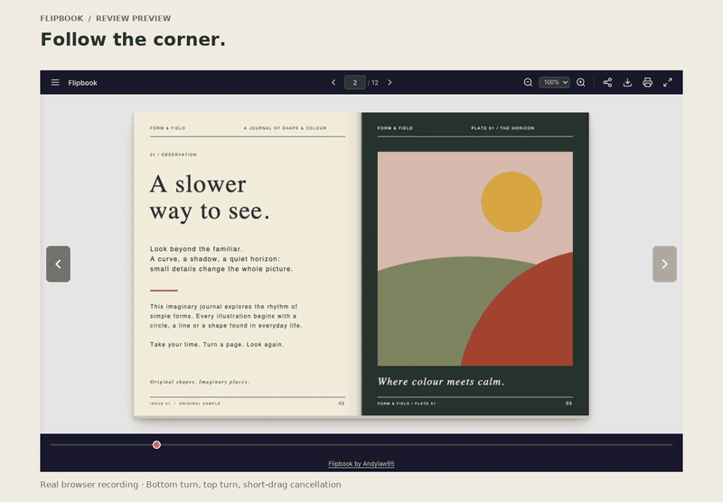

# Notes and corner curl — review preview

This branch is a review preview. The published v1.0.1 release contains the notice
clearance patch; these larger changes have not been merged or released.

Run the local server from the README and open
`/?pdf=examples/form-and-field.pdf`. Open **Menu → Notes** to try the editor.

## Watch the preview

[26-second MP4](previews/notes-curl-preview.mp4) · [Corner screenshot](previews/corner-curl.png) · [Notes screenshot](previews/notes.png) · [Raw timing results](previews/measurements.json)

Recorded from app commit `e3c704d9f58c9f42fe2e0fff959d7667dce15a34` using normal mouse/touch input and real viewport frames. The reader was loaded before recording. The phone segment uses browser emulation. The 25 fps capture contains no interpolated or generated app frames, browser address bars, external assets, private branding or personal data. Original sample artwork is included under the root license. Video typography uses DejaVu; its [notice](media/LICENSE-DejaVu.txt) is retained.

## Notes

- Add a note for the whole document or any page. Page buttons return to that page.
- Edit, delete, and undo the last 20 changes in the current session. Escape cancels
  editing; Ctrl/Command+Enter saves. Closing the sidebar returns focus to its menu.
- Export readable TXT or a JSON backup. Restore merges matching-document backups;
  conflicting versions remain separate notes. Undo can reverse a restore.
- Notes stay in this browser and origin. There is no account, server, or sync.
  Clearing site data removes saved notes. Export a backup before clearing data.
- If storage is denied, full, unreadable, or changed by another tab, the current
  session stays editable and exportable. A visible status explains the limitation.
- Document identity uses SHA-256 of the PDF bytes, computed only when Notes opens.
  A PDF.js fingerprint is the fallback if browser hashing is unavailable. Renaming
  the same PDF retains its notes; replacing the file with different bytes separates
  notes when hashing is available. No filenames are used as identity keys.
- Notes are plain text, up to 500 notes of 20,000 characters each per document.
  Note content is not included in sharing links, analytics, or network requests.
  This does not add draggable sticky notes or write annotations into the PDF.

## Paper rendering

A continuous WebGL mesh uses the local PDF canvases as front and back textures.
Top and bottom drags lead from opposite corners; moving vertically changes the
fold. Lighting is interpolated across the surface, with a separate curved shadow.
The mesh and shaders are original work. No reference-service code, media, fonts,
or other proprietary assets are included.

WebGL denial, shader failure, or context loss uses the existing strip renderer.
Reduced motion continues to avoid animated turns. Keyboard navigation, short-drag
cancellation, interrupted turns, and zoom/pan use the existing interaction model.
The mesh reuses one graphics context, two page textures, and a bounded drawing
buffer; it does not create one graphics context per turn.

## Review and validation

Use the original sample for top/bottom corner drags, forward/backward turns,
short-drag cancellation, zoom/pan, fullscreen, and a narrow viewport. Check Notes
with keyboard input, reload, exports/restoration, and unavailable browser storage.

The regression suite covers Chromium and WebKit in desktop and emulated phone
viewports, face orientation, context-loss recovery, storage failure, content
identity, text injection, cross-tab preservation, and focus restoration.
A CSS visibility fallback keeps closed Notes controls out of keyboard focus even
when native `inert` is unavailable; this is tested with inert support disabled.
Physical phones and screen-reader software are not represented by these tests.

Measurements and a short screen recording accompany the draft PR. They compare
this app before and after using the same original PDF and viewports; they do not
establish a performance comparison with any third-party reader. No rendering
scheduler or cache changes were made: the baseline did not demonstrate a need.

### Local before/after measurements

Five cold browser contexts per configuration on the same Mac, served over loopback,
using the identical 12-page `examples/form-and-field.pdf`. Baseline `436a80f` has the
same tree as release commit `17e80d7`; draft app commit is `e3c704d`. Values below
are medians across the five runs, in milliseconds.

| Configuration / metric | Before | Draft |
| --- | ---: | ---: |
| Chromium desktop 1440×900: reader ready | 100.5 | 98.2 |
| Chromium: first leaf setup | 34.3 | 42.1 |
| Chromium: turn completion | 764.9 | 778.2 |
| Chromium: 95th-percentile animation-frame interval | 17.3 | 17.0 |
| WebKit phone emulation 390×844: reader ready | 94 | 95 |
| WebKit: first leaf setup | 12 | 27 |
| WebKit: turn completion | 745 | 762 |
| WebKit: 95th-percentile animation-frame interval | 18 | 18 |

The mesh adds first-turn setup work; these measurements do **not** establish a
speed improvement. No sampled animation-frame interval exceeded 33.4 ms during
the measured turns. This measures browser animation callbacks, not physical
screen presentation or GPU execution time. Small local vector PDFs, headless
browsers, and five samples are not a benchmark for large documents or real phones.
The existing rendering/cache strategy is unchanged.
